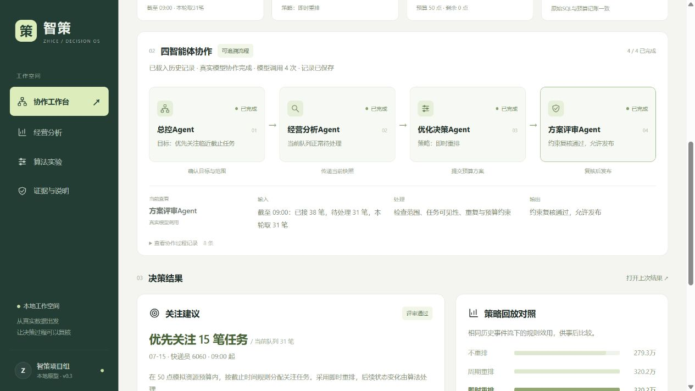

# 智策：四Agent物流决策工作台

基于 Olist 电商数据和 LaDe 末端物流数据，展示总控、经营分析、优化决策、方案评审四个角色的协作过程。支持条件筛选、经营指标复算、预算选单、历史反馈回放、策略对照及 SQL 证据查看。

## 队友下载与启动

1. 打开本仓库 [Releases 下载区](https://github.com/xmx061110/-/releases)，下载 `zhice-program-20261103.zip`（程序）和 `zhice-database-20261102.zip`（数据库）；不要只下载 GitHub 自动生成的 Source code。
2. 两包解压到同一位置，合并为同一个“智策四Agent工作台”文件夹。
3. 安装 Python 3.11 或以上（推荐 3.12，勾选 Add Python to PATH）。仅演示不需要安装 Pandas。
4. 不接模型：双击 `启动工具演练.cmd`，可查看四角色的工具流程、指标和算法结果。
5. 接模型：复制 `团队模型配置.example.json` 为 `团队模型配置.json`，私下向队长取得密钥并填写，再双击 `启动工作台.cmd`。上传版不含密钥。
6. 浏览器打开 http://127.0.0.1:8793/ 。运行窗口保持开启；端口冲突可运行 `python 启动.py --tools --port 8794`。

完整数据库压缩包约 1.94GB；解压后的数据库和程序合计约 6GB，建议预留 12GB 空间。数据库只需下载一次，后续仅更新程序包。

## 推荐演示

协作工作台选择杭州、07-15、快递员6060、预算50点；回放开始时间09:00，时长120分钟。四角色卡片可查看执行过程和输出。证据与说明可载入已保存的真实模型运行 `0b247e0076944176bbd479f0d5356f7f`。历史结果和本次新运行应区分。

## 算法

单轮选单采用 GCD 状态压缩与 Pareto 剪枝的 0-1 背包动态规划；稳定重规划加入切换代价、2%增益门槛和10分钟冷却。200个固定 LaDe 历史场景对比中，方案增删项减少16.01%，求解次数减少37.13%，规则效用下降2.91%。这是稳定性与规则效用的取舍，不能解释成真实物流延误改善。

详细说明见 [算法与优化说明.md](算法与优化说明.md)。完整 Python 源码、前端、模型文件、测试和验收报告包含在程序包内 `zhice-phase1/`；数据库独立放在 Releases 附件中。

## 数据与边界

Olist 与 LaDe 独立建库，没有按订单直接合并。当前为历史回放和模拟资源分配，资源点不是真实人民币成本；四角色可调用同一模型，尚未接入生产物流系统或华为云。

Olist 来源及许可 CC BY-NC-SA 4.0；LaDe 数据卡标示 Apache-2.0，原始 README 另有研究用途说明。原文和来源清单随数据库包保留，具体见程序内 `zhice-phase1/DATA-ATTRIBUTION.md`。

本仓库为私有仓库；组员需获得仓库访问权限后才能查看或下载。

如果通过 Git 克隆源码，把数据库包中 `智策四Agent工作台/zhice-phase1/data` 的内容放到本仓库 `zhice-phase1/data`，即可从仓库根目录启动。
