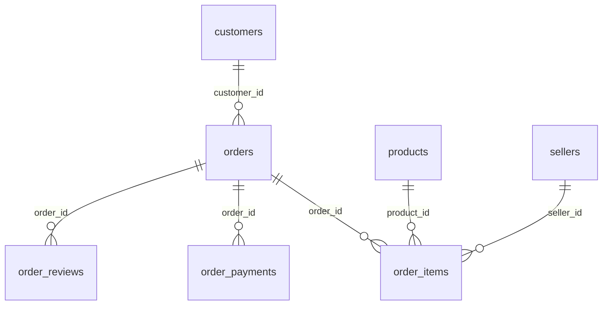

# 数据字典与表关系

原始数据：[Olist / Kaggle](https://www.kaggle.com/datasets/olistbr/brazilian-ecommerce)。所有行数、缺失值与范围均由本地完整 CSV 计算。

## 表粒度与关联

| 表 | 原始行数 | 字段数 | 主键/粒度 |
|---|---:|---:|---|
| customers | 99,441 | 5 | customer_id |
| geolocation | 1,000,163 | 5 | 无自然主键；一条地理点记录 |
| orders | 99,441 | 8 | order_id |
| order_items | 112,650 | 7 | order_id + order_item_id |
| order_payments | 103,886 | 5 | order_id + payment_sequential |
| order_reviews | 99,224 | 7 | 一条评价记录；review_id 与 order_id 均非唯一 |
| products | 32,951 | 9 | product_id |
| sellers | 3,095 | 4 | seller_id |
| category_translation | 71 | 2 | product_category_name |

主外键在清洗数据库中创建约束，六条核心关系逐条检查。类别翻译不完整，不强制作为商品类别外键；邮编前缀也不直接关联原始地理多行表。

客户 customer_id 标识订单对应的客户记录，customer_unique_id 才用于跨订单客户归并。金额为巴西雷亚尔（BRL），没有汇率换算；时间保留源数据无时区的本地墙钟时间，不推断为 UTC。

## customers

文件：`olist_customers_dataset.csv`。

| 字段 | 语义类型 | 说明 | 缺失行 | 非空不同值 | 非法格式 | 范围 |
|---|---|---|---:|---:|---:|---|
| customer_id | text | 订单对应的客户记录标识；不可当作跨订单自然人标识 | 0 | 99,441 | 0 | — |
| customer_unique_id | text | 跨订单客户标识，用于复购分析 | 0 | 96,096 | 0 | — |
| customer_zip_code_prefix | text | 邮编前缀，保留前导零 | 0 | 14,994 | 0 | — |
| customer_city | text | 客户城市，保留原文 | 0 | 4,119 | 0 | — |
| customer_state | text | 客户州代码 | 0 | 27 | 0 | — |

## geolocation

文件：`olist_geolocation_dataset.csv`。

| 字段 | 语义类型 | 说明 | 缺失行 | 非空不同值 | 非法格式 | 范围 |
|---|---|---|---:|---:|---:|---|
| geolocation_zip_code_prefix | text | 邮编前缀；一对多，不是主键 | 0 | 19,015 | 0 | — |
| geolocation_lat | real | 纬度，度 | 0 | 717,372 | 0 | -36.6053744107061 至 45.06593318269697 |
| geolocation_lng | real | 经度，度 | 0 | 717,615 | 0 | -101.46676644931476 至 121.10539381057764 |
| geolocation_city | text | 城市原文，可能存在拼写变体 | 0 | 8,011 | 0 | — |
| geolocation_state | text | 州代码 | 0 | 27 | 0 | — |

## orders

文件：`olist_orders_dataset.csv`。

| 字段 | 语义类型 | 说明 | 缺失行 | 非空不同值 | 非法格式 | 范围 |
|---|---|---|---:|---:|---:|---|
| order_id | text | 订单主键 | 0 | 99,441 | 0 | — |
| customer_id | text | 客户表外键 | 0 | 99,441 | 0 | — |
| order_status | text | 订单快照状态，不代表完整状态流转历史 | 0 | 8 | 0 | — |
| order_purchase_timestamp | datetime | 下单时间；月份归属依据 | 0 | 98,875 | 0 | 2016-09-04 21:15:19 至 2018-10-17 17:30:18 |
| order_approved_at | datetime | 付款获批时间，可缺失 | 160 | 90,733 | 0 | 2016-09-15 12:16:38 至 2018-09-03 17:40:06 |
| order_delivered_carrier_date | datetime | 订单级交运时间，可缺失；不是各商家独立发货时间 | 1,783 | 81,018 | 0 | 2016-10-08 10:34:01 至 2018-09-11 19:48:28 |
| order_delivered_customer_date | datetime | 实际送达时间，可缺失 | 2,965 | 95,664 | 0 | 2016-10-11 13:46:32 至 2018-10-17 13:22:46 |
| order_estimated_delivery_date | datetime | 预计送达日期；延迟比较采用日历日 | 0 | 459 | 0 | 2016-09-30 00:00:00 至 2018-11-12 00:00:00 |

## order_items

文件：`olist_order_items_dataset.csv`。

| 字段 | 语义类型 | 说明 | 缺失行 | 非空不同值 | 非法格式 | 范围 |
|---|---|---|---:|---:|---:|---|
| order_id | text | 订单外键；与 order_item_id 组成主键 | 0 | 98,666 | 0 | — |
| order_item_id | integer | 订单内商品行序号；每行一件商品，不是数量字段 | 0 | 21 | 0 | 1.0 至 21.0 |
| product_id | text | 商品外键 | 0 | 32,951 | 0 | — |
| seller_id | text | 商家外键 | 0 | 3,095 | 0 | — |
| shipping_limit_date | datetime | 商品行发货截止时间 | 0 | 93,318 | 0 | 2016-09-19 00:15:34 至 2020-04-09 22:35:08 |
| price | money | 商品行成交价，BRL；不含运费；不是成本 | 0 | 5,968 | 0 | 0.85 至 6735.0 |
| freight_value | money | 商品行收取的运费，BRL；不是可确认的实际物流成本 | 0 | 6,999 | 0 | 0.0 至 409.68 |

## order_payments

文件：`olist_order_payments_dataset.csv`。

| 字段 | 语义类型 | 说明 | 缺失行 | 非空不同值 | 非法格式 | 范围 |
|---|---|---|---:|---:|---:|---|
| order_id | text | 订单外键；与 payment_sequential 组成主键 | 0 | 99,440 | 0 | — |
| payment_sequential | integer | 同一订单付款记录序号；多记录不等于重复 | 0 | 29 | 0 | 1.0 至 29.0 |
| payment_type | text | 支付方式；保留 not_defined | 0 | 5 | 0 | — |
| payment_installments | integer | 分期期数；不得再乘以 payment_value | 0 | 24 | 0 | 0.0 至 24.0 |
| payment_value | money | 该支付记录总金额，BRL；没有退款流水 | 0 | 29,077 | 0 | 0.0 至 13664.08 |

## order_reviews

文件：`olist_order_reviews_dataset.csv`。

| 字段 | 语义类型 | 说明 | 缺失行 | 非空不同值 | 非法格式 | 范围 |
|---|---|---|---:|---:|---:|---|
| review_id | text | 评价标识；源数据不唯一，不能单独作为主键 | 0 | 98,410 | 0 | — |
| order_id | text | 订单外键；一个订单可能有多条评价 | 0 | 98,673 | 0 | — |
| review_score | integer | 1至5分；1、2分为本项目低评分 | 0 | 5 | 0 | 1.0 至 5.0 |
| review_comment_title | text | 评价标题，可缺失，不填充为负面评价 | 87,656 | 4,527 | 0 | — |
| review_comment_message | text | 评价正文，可缺失 | 58,247 | 36,159 | 0 | — |
| review_creation_date | datetime | 评价创建日期 | 0 | 636 | 0 | 2016-10-02 00:00:00 至 2018-08-31 00:00:00 |
| review_answer_timestamp | datetime | 评价填写时间；选择最新有效评分的排序依据 | 0 | 98,248 | 0 | 2016-10-07 18:32:28 至 2018-10-29 12:27:35 |

## products

文件：`olist_products_dataset.csv`。

| 字段 | 语义类型 | 说明 | 缺失行 | 非空不同值 | 非法格式 | 范围 |
|---|---|---|---:|---:|---:|---|
| product_id | text | 商品主键 | 0 | 32,951 | 0 | — |
| product_category_name | text | 葡萄牙语类别代码；缺失单独归入 __unknown__ | 610 | 73 | 0 | — |
| product_name_lenght | integer | 商品名称字符数；原始拼写保留 | 610 | 66 | 0 | 5.0 至 76.0 |
| product_description_lenght | integer | 商品描述字符数；原始拼写保留 | 610 | 2,960 | 0 | 4.0 至 3992.0 |
| product_photos_qty | integer | 商品图片数 | 610 | 19 | 0 | 1.0 至 20.0 |
| product_weight_g | integer | 重量，克；缺失不臆造 | 2 | 2,204 | 0 | 0.0 至 40425.0 |
| product_length_cm | integer | 长度，厘米 | 2 | 99 | 0 | 7.0 至 105.0 |
| product_height_cm | integer | 高度，厘米 | 2 | 102 | 0 | 2.0 至 105.0 |
| product_width_cm | integer | 宽度，厘米 | 2 | 95 | 0 | 6.0 至 118.0 |

## sellers

文件：`olist_sellers_dataset.csv`。

| 字段 | 语义类型 | 说明 | 缺失行 | 非空不同值 | 非法格式 | 范围 |
|---|---|---|---:|---:|---:|---|
| seller_id | text | 商家主键 | 0 | 3,095 | 0 | — |
| seller_zip_code_prefix | text | 商家邮编前缀，保留前导零 | 0 | 2,246 | 0 | — |
| seller_city | text | 商家城市原文 | 0 | 611 | 0 | — |
| seller_state | text | 商家州代码 | 0 | 23 | 0 | — |

## category_translation

文件：`product_category_name_translation.csv`。

| 字段 | 语义类型 | 说明 | 缺失行 | 非空不同值 | 非法格式 | 范围 |
|---|---|---|---:|---:|---:|---|
| product_category_name | text | 葡语类别主键；不覆盖全部商品类别 | 0 | 71 | 0 | — |
| product_category_name_english | text | 英语类别名称，仅用于展示 | 0 | 71 | 0 | — |

## 数据库派生层

- `raw_*`：保留源字段文本，新增 `_source_row` 为含表头的 CSV 逻辑记录序号；评论内换行不等于新记录。原 CSV 字节单独保留。
- `clean_*`：仅移除完全重复记录；日期标准化、数值显式转换。原金额文本旁新增 `_cents`，用 Decimal 转为整数分。
- `fact_orders`：一单一行，商品、付款先各自汇总，评价按规则选一条后再关联；主键 order_id。
- `fact_order_seller`：视图，一订单一商家一行；商品金额分摊按真实商品归属，不分摊整单付款。
- `dim_zip_geolocation`：一邮编前缀一行，经纬度为去重后有效点的中位数；只供展示，不参与指标。
- `build_metadata`：原始数据指纹、指标契约版本、成本可用性。

### fact_orders 关键字段

| 字段 | 含义 |
|---|---|
| order_month | 下单时间的 YYYY-MM；非送达月份 |
| item_count / seller_count | 商品行数 / 商家去重数；无商品记录为 0 |
| item_subtotal_cents / freight_cents | 全状态商品合计 / 收取运费；无商品记录为 NULL |
| paid_total_cents / payment_record_count | 全状态付款合计 / 有效付款记录数；无付款时金额为 NULL，记录数为 0 |
| review_id / review_score / canonical_review_source_row | 最新有效评价及其原始记录定位 |
| delivery_eligible / delivery_late | 是否纳入送达延迟分母 / 是否晚于预计日；不合格订单延迟为 NULL |
| delivery_delay_calendar_days | 实际日减预计日，可为负；仅分母内有值 |
| handoff_eligible / carrier_late_proxy | 单商家、有效日期样本 / 交运晚于最早商品发货截止的代理值 |
| payment_item_difference_cents | 付款减商品价减收取运费；不自动冲平 |
| profit_cents | 始终 NULL：缺少真实成本与费用 |

完整数据库建表及索引见 `database-schema.sql`；全部字段统计见 `data-profile.json`。
